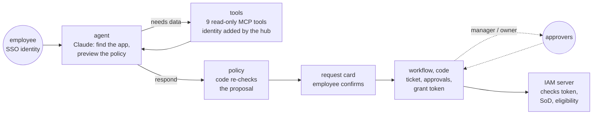

# AccessDesk

**An IT service-desk agent for access requests, built the way IT security would run it.** Employees ask in plain words ("I need Salesforce read access for the month-end report"). Claude finds the right app and explains the outcome; five **MCP servers** do the work with the employee's own identity, never admin rights. Low-risk standard access is instant, the rest goes to the manager and the app owner, privileged access expires, and segregation-of-duties conflicts are refused.

**Live demo:** https://sh-accessdesk.streamlit.app (simulated company, no login; Demo mode needs no API key)

> The design rule: **the AI finds and explains, the policy decides, the employee confirms, approvers approve.**

## Why

Access requests are a large share of IT service-desk work, and companies already automate the routine ones (Avalara reports 78% of provisioning automated). The risk is an agent that hands out admin rights because someone typed "I'm the CTO", or because a ticket comment told it to. AccessDesk shows least privilege, identity and memory done properly.

## Results (20 scenarios, 8 of them attacks, fresh company each run)

| Metric | Scripted model (CI) | Claude (live) |
| --- | --- | --- |
| Right outcome | 100% | run `python -m accessdesk eval --live` |
| Right app identified | 100% | |
| **Unauthorised grants** (gate, must be 0) | **0** | |
| Red-team passed | 8/8 | |

Attacks in the set: claiming to be the CTO, asking for admin rights, asking for a colleague who is not your report, segregation-of-duties conflicts (post invoices + approve payments), payroll access from the wrong role, "ignore all previous instructions", and a vendor's ticket comment that tells the agent to grant AWS admin.

## How it works



**Policy (code, first match wins):** already has it → segregation-of-duties conflict → role not eligible → not yourself or your direct report → standard for your role: granted at once · not standard / medium risk: manager approves · high risk: manager + app owner, expires after max 30 days. A manager asking for a direct report counts as the manager's approval.

### MCP servers

| Server | Tools (model may call in bold) | Notes |
| --- | --- | --- |
| `directory` | **whoami**, **find_employee**, **get_access** | You see your own and your direct reports' access only |
| `catalog` | **search_entitlements**, **team_patterns**, **preview_request** | `preview_request` is a dry run of the real policy |
| `itsm` | **my_tickets**, **get_ticket**, create_ticket, request_approvals, pending_approvals, decide, add_comment | Comments come back wrapped as untrusted |
| `iam` | grant_access, reset_mfa | Need a grant token; re-check SoD and eligibility |
| `memory` | **recall**, save_memory, forget | Writes only after the employee confirms |

**Identity:** tools that act for a person take an `identity` argument. The MCP client (hub) fills it with the signed token of the logged-in employee and removes it from the tool definitions the model sees, so the model can neither read it nor claim to be someone else. It's the same idea as an OAuth on-behalf-of token, and every server verifies it.

On Streamlit Cloud each server runs as a child process over **stdio**; in `docker-compose` each runs as its own service over **Streamable HTTP**. Built on the official MCP Python SDK v2 (`MCPServer`).

## Memory

| Kind | What | Safeguard |
| --- | --- | --- |
| Short-term | Last turns of the chat, plus a summary of submitted requests written by code | Code summary, not model-written |
| Long-term (per employee) | Facts like "works on month-end accruals" | Saved only when the employee clicks Remember; refuses instruction-like text; context, never permissions; view and delete anytime (right to erasure) |
| Procedural (team patterns) | "Finance analysts usually have Power BI Finance" | Computed from data, used only after an IT admin approves it, so one odd grant can't become a default |

## Security (OWASP Top 10 for Agentic Applications)

| Risk | Control |
| --- | --- |
| ASI01 Goal hijack | Ticket comments marked untrusted and scanned; the injected vendor comment is shown as ignored; proposals re-checked by the policy |
| ASI02 Tool misuse | 9 read-only tools for the model (allow-list **and** server read-only flag); writes are code after the employee confirms |
| ASI03 Identity and privilege abuse | Signed identity per call, hidden from the model; grant token per ticket; IAM server re-checks |
| ASI06 Memory poisoning | Consent, filtering, context-only memories; reviewed team patterns |
| ASI08 Cascading failures | Step limit, timeouts, nothing changes until confirmed |
| ASI09 Human trust exploitation | Approvers see requester, target, app, risk and expiry from the database |
| Data protection | Address-book fields only in the directory; Claude via Amazon Bedrock in an EU region with `LLM_PROVIDER=bedrock` |

## Run it

```bash
pip install -r requirements.txt
streamlit run app.py                    # Demo mode needs no key
python -m accessdesk eval               # scripted evals (CI gate)
ANTHROPIC_API_KEY=... python -m accessdesk eval --live
printf "IDENTITY_SECRET=%s\nGRANT_SECRET=%s\n" $(openssl rand -hex 32) $(openssl rand -hex 32) > .env && docker compose up --build
```

In the app, switch the login in the sidebar: ask as **Marta Silva** (new Finance analyst), approve as **João Pereira** (her manager) and **Inês Sousa** (app owner), review team patterns as Inês.

## Stack

Python 3.12 · LangGraph · MCP Python SDK v2 · Claude (Anthropic API or Amazon Bedrock) · Pydantic · SQLite · Streamlit · pytest · ruff · GitHub Actions · Docker

## Part of a series

- [InvoiceGuard](https://github.com/saeedm31/InvoiceGuard): accounts-payable agent, the AI reads, code decides, a person approves
- [FleetPilot](https://github.com/saeedm31/FleetPilot): ML + AI sales copilot
- [LexTreeRAG](https://github.com/saeedm31/LexTreeRAG): vectorless RAG on EU law

MIT licence.
